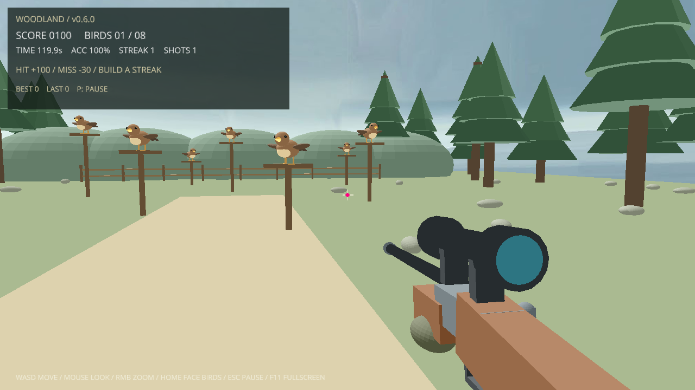
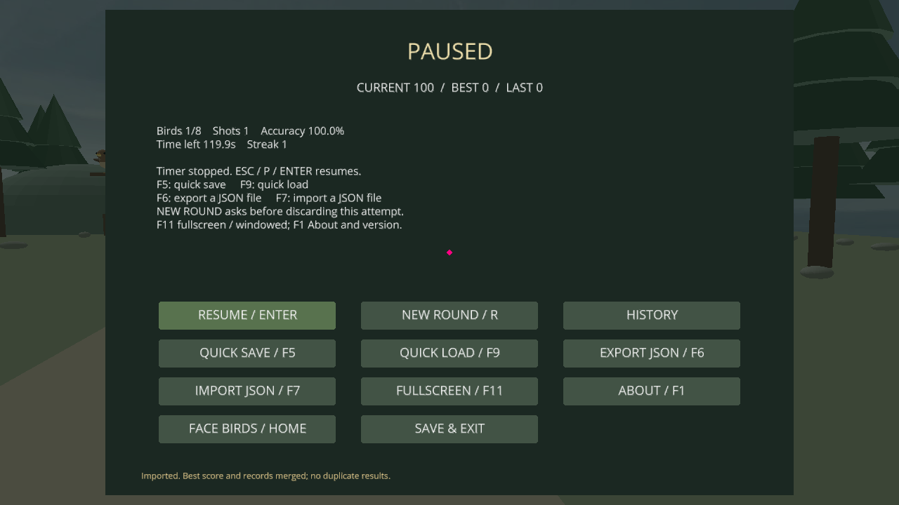
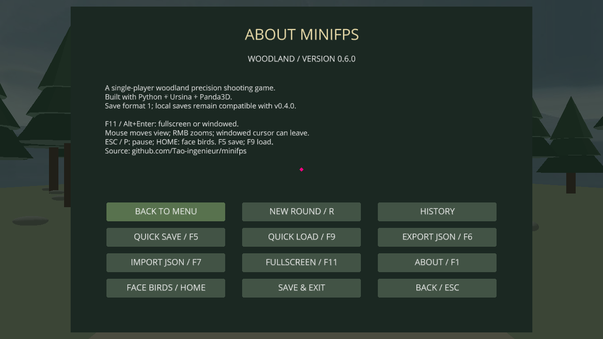
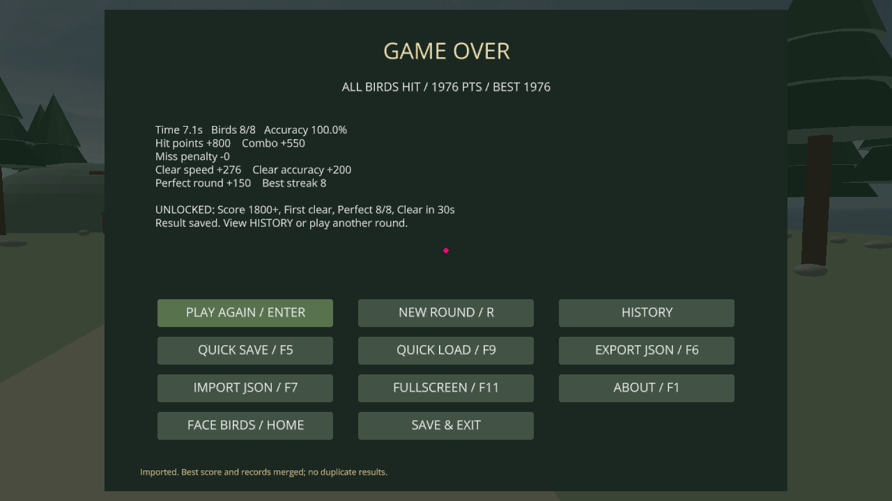

# MiniFPS Woodland v0.6.0

一个极简 Windows 第一人称林间猎鸟靶场，使用 Python + Ursina。可辨认的多部件 3D 猎枪包含木质枪托、金属枪管、瞄准镜和持枪手；鸟有头、喙、眼睛、双翼、脚与尾羽，栖息在林间木桩上。每局有 8 只静态鸟，朝向随机；场景与栖息位置固定，确保跨次启动读档时布局一致。

WASD 移动，鼠标瞄准，左键射击。启动后先显示规则菜单，点击 START 或按 Enter 开始一局 120 秒挑战。击中全部 8 只鸟或用时结束后显示 Game Over、逐项得分和总分，可按 R / Enter 或点击 PLAY AGAIN 重新开始。ESC 暂停或继续并释放鼠标，不再直接退出；退出请使用菜单 SAVE & EXIT。

当前版本 **v0.6.0**。每个版本的具体改动见 [更新日志](CHANGELOG.md)，可下载历史源码或查看 [GitHub Releases](https://github.com/Tao-ingenieur/minifps/releases)。前两版已根据原始提交补记历史记录。






## 全屏、鼠标与 About

- **F11 / Alt+Enter** 或菜单中的 FULLSCREEN / WINDOWED 切换全屏与普通窗口。切换时暂停，按 ESC / Enter 继续；返回窗口会恢复原来的尺寸和位置。
- **窗口模式默认自由鼠标**，可直接移出游戏去操作其他程序。鼠标在窗口内移动即可转动视角，无需按 Home 或右键。按住右键时临时捕获鼠标并放大瞄准，可连续转动；松开立即释放。离窗、返回和捕获切换时跳过重定位位移，避免视角跳动。左键沿屏幕中心准星射击。鼠标移出窗口不会打断移动；实际切换到其他程序、游戏失焦时才自动暂停。
- **全屏模式**在游玩时自动捕获鼠标，直接移动鼠标控制视角；ESC / P 暂停后立即释放鼠标，Alt+Tab 失焦也会自动暂停。
- **ESC 不退出游戏**：游玩时暂停，暂停时继续；About/历史页返回菜单，确认页取消；首页或结算页也不会退出。退出请点击 SAVE & EXIT 并确认，或关闭窗口。
- **ABOUT / F1** 显示当前版本号 **v0.6.0**、操作说明、技术栈及项目地址。标题栏和游戏 HUD 同样显示版本号。
- 存档格式保持 1，之前 v0.4.0 的进度与玩家纪录可以继续读取。

## 存盘、继续与玩家成绩

默认存档保存在 `%LOCALAPPDATA%\MiniFPS`，即 Windows 当前用户的本地应用数据目录，不依赖 exe 所在位置。新版本覆盖 exe 后，档案与最高分仍会保留。游戏是本地单人档案，无需注册或联网。

| 操作 | 按键 / 菜单 |
| --- | --- |
| 暂停 / 继续 | ESC / P；暂停菜单也可按 Enter 继续 |
| 快速存盘 | F5 / QUICK SAVE，保存后停在暂停页 |
| 快速读档 | F9 / QUICK LOAD；有当前进度时先确认 |
| 导出便携存档 | F6 / EXPORT JSON，选择保存位置 |
| 导入便携存档 | F7 / IMPORT JSON，选择之前导出的 JSON |
| 找回目标视角 | Home / FACE BIRDS，朝向最近的剩余小鸟，不改变分数与位置 |
| 重开本局 | R / NEW ROUND；局中先确认，不清除最高分 |
| 看历史与成就 | 暂停或结算菜单的 HISTORY |
| 控制视角 / 放大瞄准 | 直接移动鼠标；右键放大，窗口模式右键另有临时捕获功能 |
| 保存并退出 | 菜单 SAVE & EXIT 并确认；关闭窗口也触发保存 |

存档包含剩余目标、玩家位置与视角、当前分数所需的命中/发数与连击、已用时间和射击冷却。F9 / 导入读档后停在暂停页，继续前不消耗时间；首页 CONTINUE 会直接继续。暂停、离线及文件选择器打开期间都不计时；切出窗口也会自动暂停。

游戏会在每次有效射击后、每 10 秒、暂停、结算和正常退出时保存到 `autosave.json`。下次启动点击 CONTINUE 会恢复并直接继续游玩，不需要再次按继续。F5 保存的是独立的 `quicksave.json` 检查点，之后的新局与自动保存不会覆盖它。F6 导出的是可复制到其他电脑的独立 JSON 文件，F7 导入后合并本机档案。

**当前分**是本局实时分数，可为负；**最高分**是已完成清场或超时局的最高结算分；**上一局分数**是最近完成局的结算分。新局清零当前分，最高分和历史成绩继续保留。导入旧备份不会降低本机最高分、最快清场或成就。最近 20 局记录包括得分、用时、命中率和清场/超时状态；同一局重复导入不会重复累计局数，重新挑战旧检查点取得更好结果可以提高最高分。

额外成就包括：首次清场、8 发全中、30 秒内清场、结算达到 1800 分。成就记录在本地档案中，结算页显示本次新解锁项目。

存档采用 JSON 校验与原子写入，并保留上一版 `.bak` 备份；自动/快速存档损坏时尝试恢复备份。原损坏文件在被替换前保留 `.corrupt-*` 副本。写入失败会显示提示，保存失败退出时需要再次确认；无效导入不会覆盖当前局。存档仅用于本地离线游戏，不作为线上竞技成绩认证。

如果看不到目标，可按 **Home** 快速转向最近的小鸟，无需重开或放弃当前分数。v0.6.0 修正了窗口模式普通鼠标无法转动视角的问题；Home 仅是辅助找回方向。v0.5.1 修正了自由鼠标导致的误暂停；若菜单显示 PAUSED，ESC / Enter 可继续。

## 积分规则

积分侧重命中与准确率，速度只作为清场加分，不乘算整局成绩。

| 项目 | 规则 |
| --- | --- |
| 命中小鸟 | +100 分 |
| 连续命中 | 第 2、3、4 次分别额外 +25、+50、+75；第 5 次起每次额外 +100 |
| 空枪 | -30 分并清空当前连击；打到地面、木桩、树或边界也算空枪 |
| 清场速度奖励 | `floor(300 × max(0, 1 - 用时秒数 / 90))`，最多 +300；90 秒之后为 0 |
| 清场准确率奖励 | `200 × 命中数 / 有效射击数`，四舍五入到整数，最多 +200 |
| 全中额外奖励 | 8 发命中 8 只鸟，额外 +150 |
| 超时 | 120 秒结束本局，保留命中/连击分和空枪扣分，不发任何清场奖励 |
| 最终总分 | `max(0, 命中分 + 连击分 - 空枪扣分 + 清场奖励)` |

实时分数允许为负，避免先乱开枪再命中逃避惩罚；最终结算最低 0 分。准确率在未开枪时显示 0%。射击间隔 0.30 秒，冷却期点击不算发数或空枪；结算后无法继续射击刷分。计时使用单调时钟，游戏加载时间不计入比赛，游玩时不会因为低帧率而变慢，暂停和离线时间不计入。

例如：40 秒内用 8 发全部命中，得分为 `800 命中 + 550 连击 + 166 用时 + 200 准确率 + 150 全中 = 1866 分`。

清场显示 **GAME OVER / ALL BIRDS HIT**，超时显示 **GAME OVER / TIME UP**。结算后释放鼠标、停止移动并冻结得分和用时。重新开始会重置当前局计分、8 只鸟、玩家位置和视角；树林与木桩复用，玩家档案中的最高分和历史不变。

## 目录

```text
simplei-fps/
├── minifps/                  # 仅此目录上传 GitHub
│   ├── src/minifps.py        # 启动入口
│   ├── src/woodland/         # 按功能拆分的游戏模块，无需外部贴图
│   ├── requirements.txt
│   ├── requirements-build.txt
│   ├── build.ps1
│   └── README.md
└── minifps-local/            # 不上传 GitHub
    ├── .venv/               # 本机依赖环境
    ├── build/               # PyInstaller 中间产物
    ├── dist/MiniFPS.exe     # 可以直接分发的单文件程序
    └── MiniFPS.spec
```

## 安装与运行

开发电脑使用 Windows 10/11 x64，安装 Python 3.12 x64（python.org 官方安装器）；游戏玩家运行 exe 不需要安装 Python。

在 `minifps` 目录打开 PowerShell。以下命令无需激活虚拟环境：

```powershell
py -3.12 -m venv ..\minifps-local\.venv
& ..\minifps-local\.venv\Scripts\python.exe -m pip install --upgrade pip
& ..\minifps-local\.venv\Scripts\python.exe -m pip install -r requirements.txt
& ..\minifps-local\.venv\Scripts\python.exe src\minifps.py
```

在规则菜单点击 START 或按 Enter 后，窗口模式默认自由鼠标，按住右键转动视角；全屏模式捕获鼠标。W/S 前后移动，A/D 左右平移，鼠标转动视角，单击左键射击。准星下的第一个碰撞物决定命中；猎枪模型不参与碰撞。射中小鸟后小鸟消失，清场或超时后显示结算页，可按 R / Enter 或点击按钮开启新一局。ESC / P 暂停或继续；窗口模式松开右键释放鼠标。F11 切换全屏，F1 查看 About。

## 源码结构

入口仍为 `src/minifps.py`，运行命令不变。按功能维护多个文件，修改鼠标控制时无需翻阅存档或模型代码；运行源码时请保留整个 `src` 目录。

| 模块（`src/woodland/`） | 职责 |
| --- | --- |
| `config.py` | 版本号、计分参数与场地布局 |
| `controls.py` / `player.py` | 瞄准策略、光标捕获、WASD 与碰撞 |
| `world.py` / `weapon.py` / `targets.py` | 树林场景、猎枪、鸟靶与栖木 |
| `ui.py` | HUD、准星、菜单和按钮 |
| `scoring.py` | 对局状态、计分、暂停计时 |
| `profiles.py` | 最高分、历史、成就与导入合并 |
| `storage.py` / `dialogs.py` | JSON 校验、备份、原子写入与 Windows 文件对话框 |
| `game.py` | 协调各模块、射击和菜单流程 |
| `smoke.py` | 引擎内瞄准回归辅助 |

计分、玩家纪录、存档和鼠标策略可独立测试，无需初始化渲染窗口。exe 仍打包为一个可独立运行的文件，PyInstaller 自动收集这些 Python 模块。

## 打包独立 Windows exe

1. 在 Windows x64 上按前述步骤创建环境并确认源码游戏可以运行。
2. 在 `minifps` 目录安装打包依赖：

   ```powershell
   & ..\minifps-local\.venv\Scripts\python.exe -m pip install -r requirements-build.txt
   ```

3. 执行构建脚本。ExecutionPolicy 只对这次 PowerShell 子进程生效：

   ```powershell
   powershell -NoProfile -ExecutionPolicy Bypass -File .\build.ps1
   ```

4. 产物为 `..\minifps-local\dist\MiniFPS.exe`。脚本使用 `--onefile --windowed` 并收集 Ursina / Panda3D 的模型、字体、动态库等内置资源；不需要手动复制素材。首次构建可能需要几分钟，单文件启动时需要短暂解压。
   若旧版游戏还在运行，可输出到独立版本目录，无需先关闭游戏：

   ```powershell
   powershell -NoProfile -ExecutionPolicy Bypass -File .\build.ps1 -DistFolder 'dist\v0.6.0'
   ```

   本次交付的新版位于 `..\minifps-local\dist\v0.6.0\MiniFPS.exe`。

5. 双击 exe，检查移动、鼠标瞄准、射击消靶、边界碰撞和 ESC 暂停/继续。将 exe 复制到未安装 Python 的 Windows 电脑再测试；运行需要正常的显卡驱动。
6. 仅分发 `MiniFPS.exe` 即可；不必分发虚拟环境或源码。第三方引擎随包许可证位于打包资源中，可在对外分发时同时附带 `THIRD_PARTY_NOTICES.md`。

如双击无窗口或闪退，构建控制台版并从 PowerShell 启动，查看错误：

```powershell
powershell -NoProfile -ExecutionPolicy Bypass -File .\build.ps1 -Console
& ..\minifps-local\dist\MiniFPS.exe
```

控制台版与正式版输出文件名相同，后一次构建覆盖前一次。重新执行不带 `-Console` 的构建得到正式版。

可选自动自检（真实窗口短暂出现，在隔离测试目录检查存盘、重开确认、真实目标命中、位置/视角读档、导入合并、最高分与结算，然后退出，不接触真实玩家存档）：

```powershell
& ..\minifps-local\.venv\Scripts\python.exe src\minifps.py --smoke-test
# 控制台版 exe 也支持：
& ..\minifps-local\dist\MiniFPS.exe --smoke-test
```

## GitHub

Git 仓库根目录为 `minifps`，同级 `minifps-local` 不在版本控制范围内。`.gitignore` 也排除 exe、缓存、虚拟环境和构建产物。公开仓库只包含源码、依赖清单及说明。

参考：[Ursina API](https://www.ursinaengine.org/api_reference.html)、[PyInstaller 官方使用说明](https://www.pyinstaller.org/en/stable/usage.html)。


## 验证与后续发布

33 项鼠标策略、计分、暂停、档案合并及存档可靠性测试不创建游戏窗口：

```powershell
& ..\minifps-local\.venv\Scripts\python.exe -m unittest discover -s tests -v
```

后续每次发布需要更新版本号、更新日志、README、版本标签与 GitHub Release；详细步骤见 [CONTRIBUTING.md](CONTRIBUTING.md)。exe 和构建环境继续只保留在本地目录。

移动与鸟形目标显示回归测试（真实引擎帧循环，不使用玩家档案）：

```powershell
& ..\minifps-local\.venv\Scripts\python.exe src\minifps.py --movement-smoke-test --display-smoke-test
```

该测试在窗口与全屏模式分别通过真实引擎帧验证鼠标水平/垂直瞄准、持续按下 W/S/A/D，并验证位移和目标可见性；另检查 Home 后继续瞄准、离窗重入和 ESC 暂停/继续。鼠标输入使用固定采样，测试不接管桌面光标。测试窗口出现后会自动关闭。
